# Duck.ai workflow and candidate evidence

This guide describes the current GitHub Actions flow for the `duckai` branch. It covers generation, source assessment, the CSS/acknowledgment/HTML sequence, automated checks, and the evidence saved for each attempt.

## Run inputs

The **Duck.ai Website Automation** workflow starts on a push to `duckai` when `duckai_automation/source_urls.csv` changes, or when a user manually dispatches it on that branch. Changes to `website_request.txt` and `design_brief.txt` alone do not start a run. The CSV requires one row per site with `business`, `category`, and `website` columns; `location` is optional. A changed CSV processes every valid row. Manual `full_batch` mode processes the CSV or accepts a single-site URL and metadata override. Manual `smoke_test` mode selects exactly one row from the CSV by `smoke_website`, or uses the first row when that input is blank.

The target loader reads only these CSV columns:

| Column | Required | Meaning |
| --- | --- | --- |
| `website` | Yes | Source website to inspect and redesign. |
| `business` | Yes | Intended business name, sent as unverified identification context. |
| `category` | Yes | Primary industry category, sent as unverified design context. |
| `location` | No | Location clue sent as unverified context; use as a fact only if the website confirms it. |

Any other CSV columns are ignored by the current loader. The checked-in CSV has 21 rows. The business name, category, and optional location help identify the target and guide design; Duck.ai must verify metadata against the site and use the source assessment as the authority for factual claims.

Use `smoke_test` from **Actions → Duck.ai Website Automation → Run workflow** to exercise the CSV path without starting all site jobs. It runs one full candidate for one CSV row and requires one automated pass. It still performs the in-chat site assessment, CSS/`acknowledged`/HTML sequence, assembly, and Playwright QA. Select a row by entering its exact `website` value in `smoke_website`; blank selects the first CSV row. A failed one-candidate smoke run saves its evidence and marks the workflow failed for inspection.

The checked-in website request and design brief are reusable instructions, not site-specific copy. Keep them separate: the request defines scope, factual sourcing, content, assets, and output requirements; the design brief guides visual decisions. The business, category, and location values are treated as data, not instructions. The preparation job validates the CSV and creates one matrix job per website. Those jobs run serially. Each site job loops through full candidate runs until it gets three automated passes or reaches six attempts. This is one workflow execution, not three workflow executions per site. With the current 21-row CSV, the workflow can make up to 126 candidate attempts.

## End-to-end flow

```mermaid
flowchart TD
    A[CSV changed and pushed, or workflow manually dispatched on duckai] --> B[Validate CSV and create one job per target row]
    B --> C[GitHub Actions: Ubuntu and pinned Playwright Python container, one website at a time]
    C --> C1[Read business, industry category, optional location, and source URL from row]
    C1 --> C2[Start headed Chromium under Xvfb; create fresh logged-out Duck.ai chat]
    C2 --> D[Send business/category/location as unverified context]
    D --> E[Enable Web Search and request source assessment for the website]
    E --> F[Capture audit; validate source domain and any selected design reference]
    F --> G{Audit validation passes?}
    G -- Yes --> I[Use the audit, metadata, and design brief in the same chat]
    G -- No --> R[Save failure evidence for candidate]
    I --> J[Request CSS parts 1, 2, and 3]
    J --> K[Automation sends acknowledged as its own user turn]
    K --> L[Request HTML parts 1, 2, and 3 in the same chat]
    L --> M[Validate chunks; assemble HTML and CSS; create inlined index.html]
    M --> N[Playwright renders desktop and mobile; save screenshots and browser report]
    N --> O[Structural checker evaluates generated markup and browser report]
    O --> P{automated_success?}
    P -- Yes --> Q[Record automated pass; human image and visual review remain pending]
    P -- No --> R
    Q --> S{Three automated passes for this site or six attempts?}
    R --> S
    S -- No --> C2
    S -- Yes --> T[Commit this site's candidate evidence to duckai]
    T --> U{At least three automated passes for every site?}
    U -- Yes --> V[Workflow succeeds; visual approval is still a separate review]
    U -- No --> W[Workflow fails; inspect saved candidate reports]
```



One workflow execution creates one matrix job for each website row. Each matrix job runs up to six complete candidate attempts for that website, stopping early once it has three `automated_success` candidates. Website jobs are serialized to limit inference load and avoid competing commits to the branch. Each candidate uses a fresh Duck.ai chat. The workflow commits evidence for successful and failed attempts before the final step checks that this website achieved three automated passes. A batch succeeds only when every website meets that target. For 21 rows, that is 21 site jobs and up to 126 candidate attempts in one workflow execution.

### Source assessment

For each CSV row, the runner sends the business name, industry category, and optional location to Duck.ai as unverified identification and design context, then enables Web Search and requests a source assessment before requesting code. It asks Duck.ai to cite pages it reviewed on the requested domain, separate observed facts from inferences and unknowns, describe visible brand colors and design elements, and identify source-site logo and photo assets. Location must be verified by the website before being stated as fact or used to imply regional identity. If metadata disagrees with the site, the site remains authoritative for facts and Duck.ai should report the discrepancy. It may recommend a named HTML5 UP design reference with its official demo and CC BY 3.0 license when one genuinely fits; a template is optional. The runner checks that source pages match the requested domain and validates a template's details if one is selected. If source validation fails, that candidate stops before code generation.

The later generation prompt refers to the source assessment already in that chat. The runner saves the captured assessment as `debug/source_assessment.json` and `debug/source_assessment.md`, and saves effective request inputs as `debug/inputs.json`. Template credit belongs in a non-rendering HTML comment and internal notes, not visible site content. A source audit is not independent verification by a human: it is Duck.ai's cited assessment.

### Multi-turn capture

The runner requests exactly three labeled CSS parts. After the third CSS response, it sends the literal `acknowledged` as a separate user turn and waits for Duck.ai's response before requesting the three HTML parts. The source audit, CSS, acknowledgment, and HTML all remain in the same chat for that candidate. It validates each newest response and code marker before assembly; a stale, incomplete, mislabeled, or duplicate chunk cannot silently become an accepted part.

The workflow preserves captured conversation turns and chunk evidence in the candidate folder. CSS and HTML are saved separately as `files/styles.css` and `files/index.html`; the assembled CSS is also embedded into `files/inlined/index.html`. The inlined file still needs network access for remote images and fonts.

## Automated QA and human review

Playwright loads the inlined file in a browser at desktop and mobile viewports. The browser report covers:

- Requested page sections are present and visibly rendered.
- The hero spans the viewport and its image media covers the hero.
- The primary CTA appears in the first viewport.
- The mobile navigation opens/closes and can be operated by click and keyboard.
- The mobile layout has no horizontal overflow.
- Browser fonts and images load.

The structural checker evaluates the generated document and incorporates those browser results. It also checks the CTA arrow rule: CTA buttons and button-style links must not contain arrow glyphs or arrow/chevron icons. The report exposes this as `cta_buttons_no_arrows`. The generation contract gives Duck.ai the same requirement, but the checker is the enforcement point when the model ignores it.

These are deterministic browser/markup checks and do not call an AI model. Passing them sets `automated_success`; it does not establish that the images are relevant, the design is polished, or that the source-derived facts are correct. The current action does not perform the documented human image audit or screenshot-based visual design approval. Those remain pending, and `final_success` should not be interpreted as human approval.

## Candidate output layout

Each candidate attempt is stored under:

```text
duckai-runs/run-<run-id>-<attempt>-site-<site-index>-candidate-<candidate-index>/
  files/
    index.html
    styles.css
    inlined/index.html
  chunks/
  debug/
    action.log
    browser_qa.json
    checker_report.json
    inputs.json
    source_assessment.json       # when a source URL was supplied
    source_assessment.md         # when a source URL was supplied
    screenshots/
  conversation_turns.json
  run_notes.json
```

Some files are only present when the corresponding step completed; failed or partial candidates retain whatever evidence was available. `run_notes.json` summarizes the candidate's status, automated result, browser QA, source assessment, and pending human review. Read `debug/action.log` and `debug/failure.txt` first when investigating a generation failure, then inspect the chunk manifests, conversation capture, browser report, and checker report as available.

## Rechecking a saved batch

**Duck.ai Rendered Website QA** reruns browser QA and the structural checker on a committed batch, updates each candidate's QA evidence and run notes, and commits those evidence changes. It does not start new Duck.ai chats. A manual dispatch can specify a run ID and attempt; leaving the run ID blank selects the newest saved candidate batch.

## Runtime and access boundaries

Both workflows use `mcr.microsoft.com/playwright/python:v1.58.0-noble` with the repository's pinned Playwright Python package. The generation workflow launches headed Chromium with `xvfb-run` to interact with Duck.ai. The rendered-page QA workflow checks the saved local HTML separately and does not use Duck.ai. Both run on GitHub-hosted Ubuntu.

The automation uses a fresh, logged-out chat. If Duck.ai blocks guest access or presents a sign-in, usage, or human-verification gate, stop that candidate and preserve its failure report. Do not attempt to bypass the gate. The GitHub Actions token needs repository contents write access to commit candidate output.
