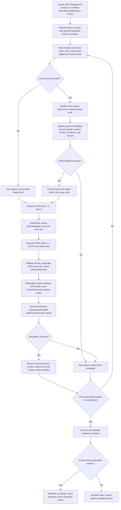

# Duck.ai workflow and candidate evidence

This guide describes the current GitHub Actions flow for the `duckai` branch. It covers generation, source assessment, the CSS/acknowledgment/HTML sequence, automated checks, and the evidence saved for each attempt.

## Run inputs

The **Duck.ai Website Automation** workflow starts on a push to `duckai` only when `duckai_automation/source_url.txt` changes, or when a user manually dispatches it on that branch. Changes to `website_request.txt` and `design_brief.txt` alone do not start a run. A manual dispatch accepts the website request, design brief, and optional source URL; a supplied URL overrides `source_url.txt`, while a blank URL falls back to that file. For a push-triggered run, the runner reads all three values from the checked-in files.

The checked-in website request and design brief are reusable instructions, not site-specific copy. The request asks Duck.ai to identify the organization from the source, assess its pages, use supported facts, and reuse suitable brand assets. The brief asks it to derive the audience, conversion goal, and visual direction from that assessment. Replace the URL in `source_url.txt` to choose a different target; this file contains a URL, not a company name. When a source URL is present, Duck.ai performs the audit itself in the candidate's chat.

## End-to-end flow



The generation action runs up to six attempts, stopping early once it has three `automated_success` candidates. Candidate attempts run sequentially, each in a fresh Duck.ai chat. It commits evidence for successful and failed attempts before the final step checks whether three automated passes were achieved.

### Source assessment

When a source URL is set, the runner enables Duck.ai Web Search and requests an assessment before requesting code. It asks Duck.ai to cite pages it reviewed on the requested domain, separate observed facts from inferences and unknowns, and recommend a named HTML5 UP design reference with its official demo and CC BY 3.0 license. The runner checks the assessment for the requested source domain and design-reference/license details. If validation fails, that candidate stops before code generation.

The later generation prompt refers to the source assessment already in that chat. The runner saves the captured assessment as `debug/source_assessment.json` and `debug/source_assessment.md`, and saves effective request inputs as `debug/inputs.json`. Template credit belongs in a non-rendering HTML comment and internal notes, not visible site content. A source audit is not independent verification by a human: it is Duck.ai's cited assessment.

### Multi-turn capture

The runner requests exactly three labeled CSS parts. After the third CSS response, it sends the literal `acknowledged` as a separate user turn and waits for Duck.ai's response before requesting the three HTML parts. The source audit, CSS, acknowledgment, and HTML all remain in the same chat for that candidate. It validates each newest response and code marker before assembly; a stale, incomplete, mislabeled, or duplicate chunk cannot silently become an accepted part.

The workflow preserves captured conversation turns and chunk evidence in the candidate folder. CSS and HTML are saved separately as `files/styles.css` and `files/index.html`; the assembled CSS is also embedded into `files/inlined/index.html`. The inlined file still needs network access for remote images and fonts.

## Automated QA and human review

Playwright loads the inlined file in a browser at desktop and mobile viewports. The browser report covers:

- Requested page sections are present and visibly rendered.
- The hero spans the viewport and its image media covers the hero.
- The primary CTA appears in the first viewport.
- The mobile navigation opens/closes and can be operated by click and keyboard.
- The mobile layout has no horizontal overflow.
- Browser fonts and images load.

The structural checker evaluates the generated document and incorporates those browser results. It also checks the CTA arrow rule: CTA buttons and button-style links must not contain arrow glyphs or arrow/chevron icons. The report exposes this as `cta_buttons_no_arrows`. The generation contract gives Duck.ai the same requirement, but the checker is the enforcement point when the model ignores it.

These are deterministic browser/markup checks and do not call an AI model. Passing them sets `automated_success`; it does not establish that the images are relevant, the design is polished, or that the source-derived facts are correct. The current action does not perform the documented human image audit or screenshot-based visual design approval. Those remain pending, and `final_success` should not be interpreted as human approval.

## Candidate output layout

Each candidate attempt is stored under:

```text
duckai-runs/run-<run-id>-<attempt>-candidate-<candidate-index>/
  files/
    index.html
    styles.css
    inlined/index.html
  chunks/
  debug/
    action.log
    browser_qa.json
    checker_report.json
    inputs.json
    source_assessment.json       # when a source URL was supplied
    source_assessment.md         # when a source URL was supplied
    screenshots/
  conversation_turns.json
  run_notes.json
```

Some files are only present when the corresponding step completed; failed or partial candidates retain whatever evidence was available. `run_notes.json` summarizes the candidate's status, automated result, browser QA, source assessment, and pending human review. Read `debug/action.log` and `debug/failure.txt` first when investigating a generation failure, then inspect the chunk manifests, conversation capture, browser report, and checker report as available.

## Rechecking a saved batch

**Duck.ai Rendered Website QA** reruns browser QA and the structural checker on a committed batch, updates each candidate's QA evidence and run notes, and commits those evidence changes. It does not start new Duck.ai chats. A manual dispatch can specify a run ID and attempt; leaving the run ID blank selects the newest saved candidate batch.

## Runtime and access boundaries

Both workflows use `mcr.microsoft.com/playwright/python:v1.58.0-noble` with the repository's pinned Playwright Python package. The generation workflow launches headed Chromium with `xvfb-run` to interact with Duck.ai. The rendered-page QA workflow checks the saved local HTML separately and does not use Duck.ai. Both run on GitHub-hosted Ubuntu.

The automation uses a fresh, logged-out chat. If Duck.ai blocks guest access or presents a sign-in, usage, or human-verification gate, stop that candidate and preserve its failure report. Do not attempt to bypass the gate. The GitHub Actions token needs repository contents write access to commit candidate output.
